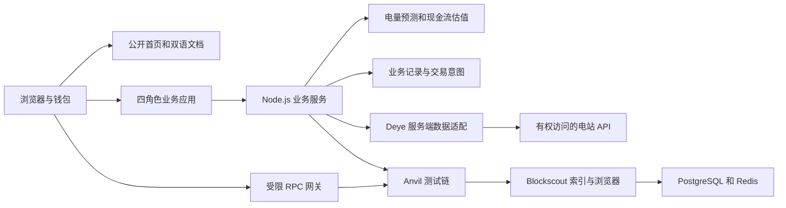
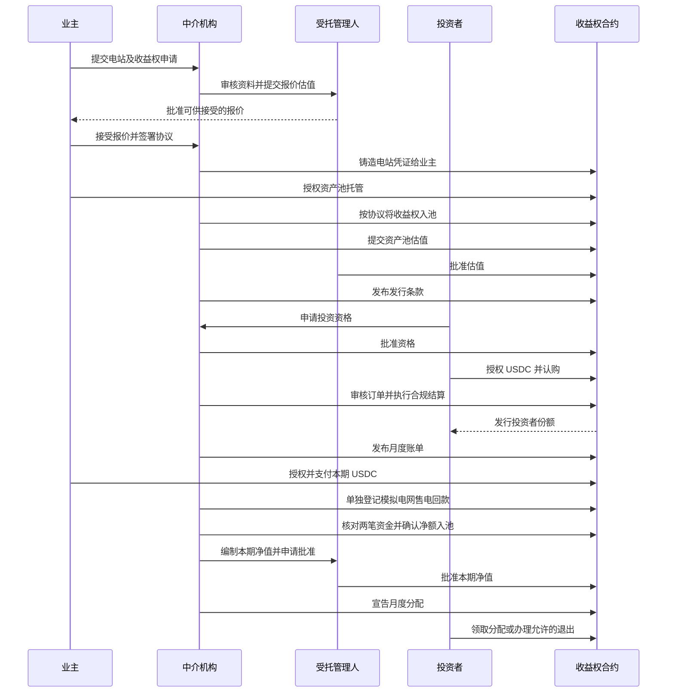

# 系统组成与业务流程

## 系统组成

系统使用 npm workspaces 管理合约、模型和应用三个工作区。首页与文档无需连接钱包，业务应用则通过钱包签名建立会话，并按地址校验角色。

Deye 接口凭证只供后端读取。适配器区分实时数据、记录回放和合成样本，保存单位、时区、字段映射和来源摘要。估值模块将观测数据与模型假设分开，计算逐期现金流、情景和折现结果。业务服务保存审核过程与交易意图，校验钱包提交的交易及预期事件，再更新业务状态。

链上合约保存电站凭证、收益权条款摘要、批准的估值摘要、认购托管、投资者份额及资金流。完整申请资料和原始电站记录不写入合约。Blockscout 从同一条链读取区块与事件，供使用者核对交易，不决定业务审核结果。

## 四角色交接

业主提供电站资料并决定是否出售约定收益权。中介负责资料审核、模型准备、产品发行和日常运营。受托管理人独立审核估值，并在约定的处置条件满足时批准收款方变更。投资者承担收益波动与流动性限制，在结算后持有份额并按规则领取分配。

## 收益模型

当前新协议采用业主电费与上网售电收入共同形成现金流的模型。业主按约定的电网参考价折扣支付符合条件的光伏用电费用。上网售电部分另按适用的售电价格计算。两者按协议归集后扣除明确约定的成本，再计算收益权价值。

业主的折扣与资产池的归集比例是两个独立参数。新协议默认归集比例为 100%，业主通过折扣保留用电优惠。不能把发电量全部视为上网电量，也不能把节约电费与已经收取的业主电费重复计入现金流。详细公式、估值示例和逐期时间轴见网站的估值及现金流文档。

投资者的份额只在成功结算后发行。产品处于募集阶段并不意味着已经发行份额。月度现金分配、剩余净值与预计净年化收益分别展示，有限期收益权到期后不存在设备残值或自动偿还原始本金的安排。

## 源码定位

`offchain/src/revenue/model.ts` 定义站点及估值模型，`pool.ts` 计算资产池现金流，`deye.ts` 负责数据适配。`ui/src/revenue/runtime.ts` 执行业务状态转换，`server.ts` 提供鉴权和 HTTP 接口，`store.ts` 管理持久化及交易意图。

主合约位于 `onchain/contracts/revenue/RevenueShareVaultV5.sol`。电站凭证使用 `onchain/contracts/core/DeyeRWA.sol`，测试资金使用 `onchain/contracts/mocks/MockUSDC.sol`。业务页面位于 `ui/public/revenue/`，公开网站位于 `ui/site/`。

月度缴费合约位于 `onchain/contracts/revenue/HouseholdBilling.sol`。它绑定当前产品、USDC、中介和独立售电模拟账户。每张账单绑定付款人、服务期和证据摘要，业主缴费后资金先进入缴费合约，不能直接当作资产池可分配现金。中介核对售电款与业主付款后，合约按约定扣费并将净额转入资产池，同时记录凭证。后台根据回执与事件恢复状态，不凭任意成功交易哈希确认付款。
